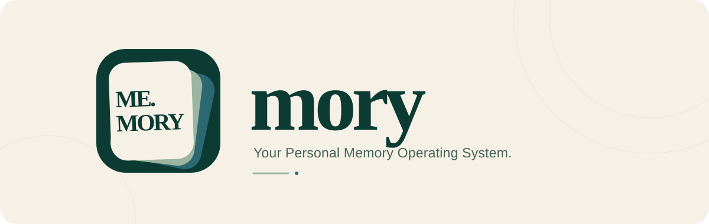
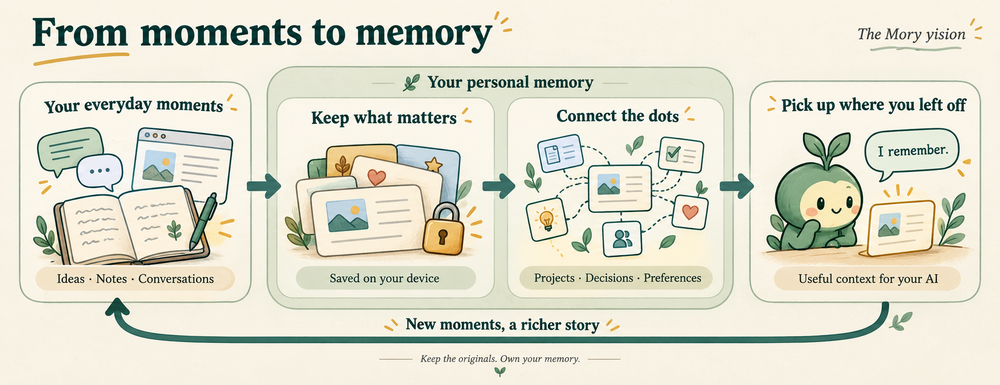

<p align="center">
  <a href="https://mory.cloud/"></a>
</p>

<h3 align="center">Let AI finally remember.</h3>

<p align="center">
  Your projects. Your ideas. Your story.<br>
  A personal memory that stays with you, wherever you use AI.
</p>

<p align="center">
  <a href="https://mory.cloud/"></a>
  <a href="#get-started"></a>
  <a href="docs/GETTING_STARTED.md"></a>
  <a href="LICENSE"></a>
  <a href="#where-we-are"></a>
</p>

<p align="center">
  <a href="#why-mory">Why Mory?</a> ·
  <a href="#vision">Vision</a> ·
  <a href="#philosophy">Philosophy</a> ·
  <a href="#get-started">Get started</a> ·
  <a href="#roadmap">Roadmap</a>
</p>

---

> We don't need smarter AI.
>
> We need AI that remembers.

---

## Why Mory?

Today's AI is incredibly capable.

Yet every conversation starts from zero.

It doesn't remember what you built yesterday.

It doesn't know how you think.

It doesn't understand years of your work.

The missing piece isn't a better model.

It's **memory**.

Mory is building a **Personal Memory Operating System** — a place for the things you want AI to remember, kept on your own device and available across your tools.

Instead of asking AI to remember you,

Mory gives you ownership of your own memory.

<p align="center">
  <a href="docs/branding/mory-memory-journey.png"></a>
</p>

<p align="center"><sub>The Mory vision — automatic capture and richer connections are still on the roadmap.</sub></p>

---

## Vision

Imagine asking:

> *"Continue the project I started six months ago."*

Instead of searching through notes, chats and repositories...

AI immediately understands:

- what project you're referring to
- why you started it
- what decisions were made
- what problems were left unsolved
- what should happen next

That's the future Mory is building.

---

## Philosophy

Mory is designed around four core principles.

### 🏠 Your memory belongs to you

Your memory belongs to you.

Keep your memories on your own device. Take them with you when you change tools.

No mandatory accounts.

No vendor lock-in.

Use the cloud when you want to sync or back up.

---

### 📜 Keep the original story

AI should never rewrite history.

Mory is designed to keep original memories separate from what AI learns from them.
Summaries and connections should help you understand the past, with a way back to
where they came from.

---

### 🌱 Let understanding grow

Mory isn't another note-taking app.

The goal is for AI to learn:

- how you write
- how you think
- what you're building
- what you're interested in

So you spend less time explaining yourself again.

---

### 🔄 Carry your memory forward

Every device should be able to hold your story.

History should be traceable.

Synchronization should be optional.

Ownership should always remain local.

---

## Memory wherever you work

The vision is to bring useful context from the places you already work:

- ⌨ Keyboard
- 📋 Clipboard
- 🌐 Browser
- 💻 VS Code
- 🐙 GitHub
- 📝 Obsidian
- 📅 Calendar
- 📧 Email
- 📂 Files
- 💬 Chat Applications

Broader app connections are on the roadmap. GitHub and Gitee sync are available today.

---

## From moments to memory

```
Save what matters → Find the connections → Pick up where you left off
```

Instead of saving everything forever,

Mory aims to turn useful moments into lasting understanding.

---

## Long-term memory

Mory doesn't simply record events.

The goal is to build understanding.

From thousands of tiny interactions, AI should gradually understand:

- your projects
- your interests
- your writing style
- your decision history
- how your ideas connect

Your second brain grows naturally over time.

---

## Roadmap

These are directions, not release dates; some pieces are already available.

### Phase 1

- A home for your memories
- Save useful moments from your clipboard and browser
- Browse your history and find things again

### Phase 2

- Daily summaries
- Connections between related ideas
- A growing understanding of your projects

### Phase 3

- Your memory across devices
- A complete copy you can keep
- Recoverable history

### Phase 4

- Phone keyboards
- Your code editor
- More ways to connect your everyday tools

---

## Where we are

Mory is in **early development**. The vision above guides what we're building;
some of it is still ahead of us.

Today, you can:

- **Keep memories in one place** with a local service and a web interface.
- **Find things again** by searching saved memories.
- **Give AI a memory** by connecting a compatible assistant.
- **Take your memories with you** through export and import.
- **Sync or back up with GitHub**, with Gitee sync also available in the web app.

Automatic capture from your everyday apps and a richer understanding of your
projects are still on the roadmap.

## Get started

Install [Node.js 22.18 or newer](https://nodejs.org/), then run:

```bash
npm install -g @illli-studio/mory
mory init
mory start
```

Open the local address printed in your terminal to explore your memories.
Your data stays in `~/.mory` (or the equivalent folder on your system).

<details>
<summary><strong>Connect your AI assistant</strong></summary>

Add Mory to an assistant that supports MCP, the connection that lets AI tools
use your memories:

```json
{
  "mcpServers": {
    "mory": {
      "command": "mory",
      "args": ["mcp"]
    }
  }
}
```

Keep the local Mory service running while your assistant uses it.

</details>

For background operation, moving data, web deployment, or contributing code,
see the [setup guide](docs/GETTING_STARTED.md).
Developers can also read the [API guide](docs/API.md).

---

## Our belief

AI models will become commodities.

Memory will not.

The future belongs to AI that truly understands its user.

Mory exists to build that memory.

## License

Mory is available under the GNU Affero General Public License v3.0 or later
for community use. Organizations that need to use Mory in a proprietary,
closed-source, or differently licensed product should obtain a separate
commercial license. See [LICENSE](./LICENSE) and
[LICENSE-COMMERCIAL.md](./LICENSE-COMMERCIAL.md).

---

<div align="center">

### Build your own memory.

### Own your own context.

### Let AI finally remember.

⭐ Star this repository if you believe memory is the missing layer of AI.

</div>
