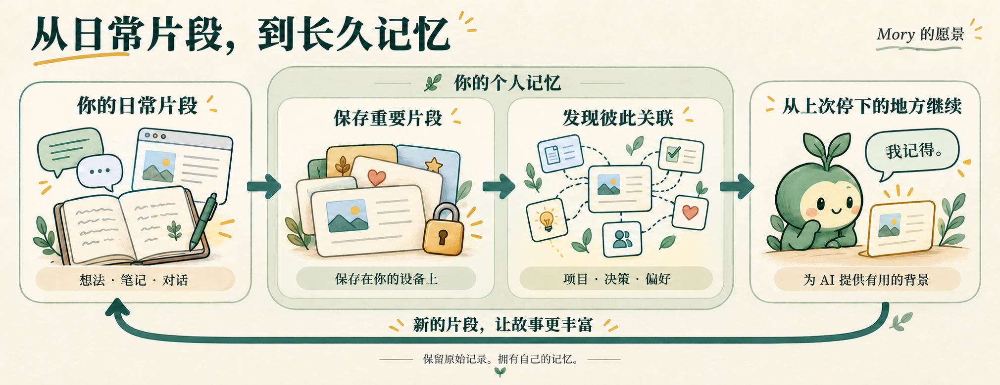

<p align="center">
  <a href="https://mory.cloud/"></a>
</p>

<p align="center"><a href="README.md">English</a> · <strong>简体中文</strong></p>

<h3 align="center">让 AI 终于记得。</h3>

<p align="center">
  你的项目。你的想法。你的故事。<br>
  无论在哪里使用 AI，你的个人记忆都与你相伴。
</p>

<p align="center">
  <a href="https://mory.cloud/"></a>
  <a href="https://me.mory.cloud/"></a>
  <a href="#开始使用"></a>
  <a href="docs/GETTING_STARTED.md"></a>
  <a href="LICENSE"></a>
  <a href="#当前进展"></a>
</p>

<p align="center">
  <a href="#为什么需要-mory">为什么需要 Mory？</a> ·
  <a href="#愿景">愿景</a> ·
  <a href="#理念">理念</a> ·
  <a href="#开始使用">开始使用</a> ·
  <a href="#路线图">路线图</a>
</p>

---

> 我们不需要更聪明的 AI。
>
> 我们需要有记忆的 AI。

---

## 为什么需要 Mory？

今天的 AI 已经非常强大。

但每一次对话，依然从零开始。

它不记得你昨天做了什么。

它不知道你如何思考。

它不了解你多年来的工作。

缺少的那一块，不是更好的模型。

是**记忆**。

Mory 正在构建一个**个人记忆操作系统**——把你希望 AI 记住的事情保存在自己的设备上，让这些记忆可以在不同工具之间使用。

与其请求 AI 记住你，

Mory 让你拥有自己的记忆。

<p align="center">
  <a href="docs/branding/mory-memory-journey.zh-CN.png"></a>
</p>

<p align="center"><sub>Mory 的愿景——自动采集和更丰富的记忆关联仍在路线图中。</sub></p>

---

## 愿景

想象一下，你只需说：

> *“继续我六个月前开始的那个项目。”*

不用再翻遍笔记、聊天记录和代码仓库……

AI 就能立刻理解：

- 你说的是哪个项目
- 你为什么开始做它
- 当时做过哪些决定
- 还有什么问题没有解决
- 接下来应该做什么

这就是 Mory 正在构建的未来。

---

## 理念

Mory 围绕四个核心原则设计。

### 🏠 你的记忆属于你

你的记忆属于你。

把记忆保存在自己的设备上。更换工具时，也能带着它们一起走。

不强制注册账号。

不被任何厂商绑定。

需要同步或备份时，再使用云端。

---

### 📜 保留最初的故事

AI 不应该改写历史。

Mory 的设计理念是将原始记忆与 AI 从中学到的内容分开保存。
摘要和关联应该帮助你理解过去，也让你能够追溯它们的来源。

---

### 🌱 让理解慢慢生长

Mory 不只是另一个笔记应用。

我们希望 AI 能逐渐了解：

- 你如何写作
- 你如何思考
- 你正在做什么
- 你对什么感兴趣

让你少一些重复解释自己的时间。

---

### 🔄 让记忆一路相随

每一台设备，都应该能够保存你的故事。

历史应该可以追溯。

同步应该由你选择。

记忆的所有权，应该始终留在你手中。

---

## 无论在哪里工作，都有记忆相伴

我们希望从你已经在使用的工具中，带来有用的背景信息：

- ⌨ 键盘
- 📋 剪贴板
- 🌐 浏览器
- 💻 VS Code
- 🐙 GitHub
- 📝 Obsidian
- 📅 日历
- 📧 邮件
- 📂 文件
- 💬 聊天应用

更多应用连接仍在路线图中。GitHub 和 Gitee 同步目前已经可用。

---

## 从日常片段，到长久记忆

```
保存重要片段 → 发现彼此关联 → 从上次停下的地方继续
```

我们希望做的，不是永远保存所有东西，

而是让有用的片段，成为长久的理解。

---

## 长期记忆

Mory 不只是记录发生过的事。

我们希望它能建立理解。

从无数细小的互动中，AI 应该逐渐了解：

- 你的项目
- 你的兴趣
- 你的写作风格
- 你做过的决定
- 你的想法如何彼此关联

你的第二大脑，会随着时间自然生长。

---

## 路线图

这些是前进的方向，不是发布日期；其中一些功能已经可用。

### 第一阶段

- 为你的记忆安一个家
- 从剪贴板和浏览器保存有用的片段
- 浏览过往，重新找到需要的内容

### 第二阶段

- 每日摘要
- 相关想法之间的联系
- 对你的项目不断加深的理解

### 第三阶段

- 跨设备使用你的记忆
- 一份可以留在自己手中的完整副本
- 可以恢复的历史记录

### 第四阶段

- 手机键盘
- 你的代码编辑器
- 连接日常工具的更多方式

---

## 当前进展

Mory 目前处于**早期开发阶段**。上面的愿景指引着我们正在构建的东西；
其中一部分仍有待实现。

现在，你可以：

- **把记忆放在一起**，通过本地服务和网页界面管理。
- **重新找到需要的内容**，搜索已经保存的记忆。
- **让 AI 拥有记忆**，连接兼容的 AI 助手。
- **带着记忆一起走**，通过导出和导入迁移数据。
- **通过 GitHub 同步或备份**，网页应用也支持 Gitee 同步。

从日常应用自动采集内容，以及对项目建立更丰富的理解，仍在路线图中。

## 开始使用

### 在线使用

打开 [me.mory.cloud](https://me.mory.cloud/)，就能在浏览器中体验并直接使用 Mory，无需安装。

### 在自己的设备上运行

安装 [Node.js 22.18 或更新版本](https://nodejs.org/)，然后运行：

```bash
npm install -g @illli-studio/mory
mory init
mory start
```

打开终端中显示的本地地址，就可以查看和管理你的记忆。
数据保存在 `~/.mory` 中（或系统中对应的文件夹）。

<details>
<summary><strong>连接你的 AI 助手</strong></summary>

将 Mory 添加到支持 MCP 的助手中。MCP 是让 AI 工具使用你的记忆的连接方式：

```json
{
  "mcpServers": {
    "mory": {
      "command": "mory",
      "args": ["mcp"]
    }
  }
}
```

助手使用 Mory 时，请保持本地 Mory 服务运行。

还可以安装配套的 [mory-memory Skill](docs/SKILLS.md)，让助手知道什么时候
检索过往、保存决定、修订或忘记记忆。Skill 使用现有 MCP 工具，需先完成上述连接。

</details>

有关后台运行、数据迁移、网页部署或贡献代码，
请参阅[安装与开发指南](docs/GETTING_STARTED.md)。
开发者也可以阅读 [API 指南](docs/API.md)。

---

## 我们的信念

AI 模型会变得随处可得。

记忆不会。

未来属于真正理解用户的 AI。

Mory 为构建这样的记忆而存在。

## 许可证

Mory 以 GNU Affero General Public License v3.0 或更新版本许可证
向社区提供。需要在专有、闭源或采用其他许可证的产品中使用 Mory 的组织，
应另行获取商业许可。详见 [LICENSE](./LICENSE) 和
[LICENSE-COMMERCIAL.md](./LICENSE-COMMERCIAL.md)。

---

<div align="center">

### 构建你自己的记忆。

### 掌握属于你的背景信息。

### 让 AI 终于记得。

⭐ 如果你也相信记忆是 AI 缺失的那一层，欢迎为这个仓库点一颗 Star。

</div>
